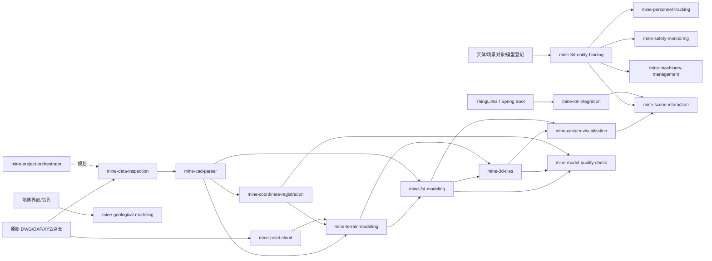

# Open Mining Skills 代码接口梳理

> 梳理对象：本仓库 17 个技能的 v0.1 实现  
> 基线：`main` @ `3cb0376`（Implement remaining fourteen skill v0.1）  
> 依据：`*/scripts/*.py`、`*/SKILL.md`、`*/references/*`、`mine-project-orchestrator/references/skills_manifest.json`  
> 梳理日期：2026-11-26  
> 方法：静态阅读 + AST 提取函数签名与 CLI 参数。本轮未执行测试（当前默认 Python 缺少 numpy / scipy / ezdxf）；仓库内共 154 个 `test_*` 函数。

---

## 0. 速览

- **17 个技能、20 个可执行脚本、17 份逐字节一致的 `common.py`、164 个测试**（154 个技能测试 + 10 个共享测试）。
- 接口分三层：**CLI（正式入口）→ 模块级函数（可导入复用）→ 文件产物（跨技能契约）**。
- 跨技能契约由 `skills_manifest.json` 的 `consumes / produces / requires` 驱动；artifact 名是抽象键（如 `terrain_mesh`），**不是文件名**。
- 接口改造已完成第一轮：共享核心模块 + 同步工具、统一 `schemaVersion` / `skill` / `result` 字段、manifest 产物对齐、补齐 `--no-fail`、增加 envelope JSON Schema。原生 `status` 保留以兼容旧调用方。剩余问题见第 6 节。

---

## 1. 仓库结构与运行模型

```
open-mining-skills/
├── shared/
│   ├── openmining_common.py  # 唯一权威的辅助模块
│   ├── schemas/              # 报告 envelope JSON Schema
│   └── tests/                # 共享模块与同步一致性测试
├── tools/
│   ├── sync_common.py        # 将共享模块同步到所有技能
│   └── run_tests.py          # 运行全部技能测试
├── mine-<skill>/
│   ├── SKILL.md              # 执行规范（Role / Input / Workflow / Deliverables / Status）
│   ├── scripts/
│   │   ├── <entry>.py        # CLI + 可导入函数
│   │   └── common.py         # 由 shared/openmining_common.py 同步生成，17 份逐字节一致
│   ├── references/*.md       # 输入输出 schema、算法与规则
│   ├── tests/test_*.py       # unittest
│   └── requirements.txt      # 可选第三方依赖
└── mine-project-orchestrator/references/skills_manifest.json
```

### 1.1 运行方式

**命令行（正式接口）**

```bash
cd mine-terrain-modeling
python3 scripts/terrain.py tests/fixtures/survey_hill.csv --out-dir terrain_output
```

脚本用同目录 `import common` 读取辅助模块，因此必须在技能目录内、或以 `scripts/` 为工作目录运行。

**Python 导入（测试在用）**

```python
import sys
from pathlib import Path

skill_dir = Path("mine-terrain-modeling")
sys.path.insert(0, str(skill_dir / "scripts"))
import terrain

report = terrain.build_tin(points)
```

### 1.2 结构性约束

- 无 `__init__.py`、无 `pyproject.toml`、无安装包，20 个脚本各自独立。
- **17 个技能都有 `scripts/common.py`，且内容逐字节一致**，由 `shared/openmining_common.py` 通过 `python3 tools/sync_common.py` 生成；每个技能目录仍可单独复制或软链接使用。
- 修改共享辅助函数：编辑 `shared/openmining_common.py` → 运行 `python3 tools/sync_common.py` → `python3 tools/run_tests.py`。不要直接编辑技能内的 `common.py`。
- **顶层模块名冲突风险**：多个技能都提供顶层模块 `common`，还有 `register` / `terrain` 等同名模块。由于所有 `common.py` 现在内容一致，同一进程内解析到哪一份行为相同；但 `register` / `terrain` 等同名业务模块仍可能冲突。彻底解决需要包化。
- 依赖矩阵：

| 技能 | 第三方依赖 |
|---|---|
| mine-cad-parser、mine-data-inspection | `ezdxf>=1.1` |
| mine-coordinate-registration、mine-model-quality-check、mine-point-cloud | `numpy>=1.24` |
| mine-terrain-modeling | `numpy>=1.24`、`scipy>=1.10` |
| 其余 11 个 | 仅标准库 |

---

## 2. 事实上的统一约定

### 2.1 CLI 形态

- 所有脚本都有 `main(argv: list[str] | None = None) -> int`，文件末尾 `sys.exit(main())`。
- 输入用位置参数；输出目录用 `--out-dir`（默认 `<something>_output`）。
- 校验类脚本用 `--output` / `--markdown` 指定报告路径；`inspect_*` 无默认路径，`validate_scene` / `validate_interactions` 有默认文件名。
- 文本列参数统一为 1-based：`--x-col` / `--y-col` / `--z-col`；分隔符 `--delimiter {",",";","tab"}`；编码 `--encoding`。
- 数据类输入约定：列下标 1-based、自动探测分隔符与表头、`UNKNOWN` 表示单位/坐标系未确认。

### 2.2 退出码

| 场景 | 行为 |
|---|---|
| 成功 | `0` |
| 校验发现 error | `1`；带 `--no-fail` 时仍写报告并返回 `0` |
| 输入不可读/非法、几何条件不满足 | `raise SystemExit("...")` → 退出码 `1`，stderr 输出原因 |
| argparse 参数错误 | `2` |
| 编排 manifest / request 非法 | `2`；计划状态 `FAILED` 时 `1` |
| 数据巡检 `inspect_*` | 恒为 `0`；不支持的格式输出 `status: "UNSUPPORTED"` |

`--no-fail` 覆盖 10 个脚本：`binding`、`validate_scene`、`validate_events`、`tracking`、`monitoring`、`machinery`、`check_model`、`validate_interactions`、`validate_tileset`、`prepare_geology`。  
`check_model` 只在整体 `status == "FAIL"` 时退出 1，`UNKNOWN` 退出 0；`inspect_*` 恒返回 0（不支持格式由报告 `status: UNSUPPORTED` 表达）。

### 2.3 stdout

- 成功时打印一行摘要 + `Outputs: ...`。
- `validate_tileset` 打印逐项 `[PASS]` / `[FAIL]`；`--json` 输出完整结果。
- `binding --entity ID` 在 stdout 输出实体查询 JSON。
- `inspect_*` 默认打印摘要；`pointcloud inspect` 未给输出参数时打印完整 JSON。

### 2.4 报告骨架的三种风格

**A. 数字孪生 / 业务校验类统一骨架**（binding、validate_events、tracking、monitoring、machinery）

```json
{
  "skill": "mine-safety-monitoring",
  "version": "v0.1",
  "status": "PASS | PASS_WITH_WARNINGS | FAIL",
  "summary": {"errors": 0, "warnings": 0, "...": "..."},
  "issues": [
    {"severity": "error | warning", "code": "CODE", "message": "...", "...": "..."}
  ],
  "sources": ["..."]
}
```

**B. 校验器风格**（validate_scene、validate_interactions、validate_tileset、check_model）

`status + summary + issues/errors`，部分没有 `skill` / `version` 字段。

**C. 业务 / 建模结果风格**（inspect_*、parse_report、registration_report、terrain_report、geology_report、model_manifest、task_plan）

各自定义 schema，需要查阅对应 `references/*-schema.md` 或 `SKILL.md` 的 Deliverables。

**统一元数据（v0.1 迁移期）**

所有 JSON 报告在写出前调用 `common.finalize_report(report, skill)`，追加：

```json
{
  "schemaVersion": "0.1",
  "skill": "mine-<skill>",
  "result": "PASS | PASS_WITH_WARNINGS | FAIL | UNKNOWN | UNSUPPORTED"
}
```

- 原生 `status` 保留，不改变旧调用方；`result` 是统一判定字段。
- `result` 的映射由 `common.normalize_status()` 完成：`ok/READY/PASS → PASS`，`invalid/FAILED/BROKEN → FAIL`，`EMPTY → UNKNOWN`，`UNSUPPORTED` 保持不变。
- 纯数据报告（如 `terrain_report.json`、`inspect_*.json`）只加 `schemaVersion` / `skill`，不加 `result`。
- Envelope schema：`shared/schemas/report-envelope.schema.json`；`shared/tests/test_common_sync.py` 会校验。

### 2.5 `common.py` 公共辅助模块

17 份 `common.py` 完全一致，源自 `shared/openmining_common.py`。主要函数：

| 分类 | 函数 |
|---|---|
| 文件与 JSON | `file_sha256(path, chunk_size=1MiB)`、`source_manifest(path)`、`read_text(path, encoding=None)`、`load_json(path)`、`read_json(path)`、`read_jsonl(path, kind="Line")`、`write_json(path, data)`、`write_text(path, text)` |
| 报告元数据 | `SCHEMA_VERSION`、`STATUS_*`、`normalize_status(value)`、`finalize_report(report, skill, status=None)` |
| 数字与文本 | `fmt(value, digits=4)`、`fmt_basic(value)`、`is_number(value)`（JSON 数字）、`is_numeric_text(value)`（文本数字）、`is_finite_number(value)` |
| 解析辅助 | `detect_delimiter(lines)`、`split_line(line, delimiter)` |
| 业务辅助 | `as_id(value)`、`as_bool(value)`、`add_issue(issues, severity, code, message, **context)`、`magnitude_clue(min_x, min_y, max_x, max_y)` |

同步与检查：

```bash
python3 tools/sync_common.py          # 重新生成 17 份 common.py
python3 tools/sync_common.py --check  # 只检查是否漂移
python3 tools/run_tests.py            # 共享测试 + 17 个技能测试
```

---

## 3. 脚本接口总表

| # | 技能 | 脚本 | 职责 | 输入 | 主要输出 |
|---|---|---|---|---|---|
| 1 | project-orchestrator | `orchestrate.py` | 意图路由、任务计划、交接校验 | 请求文本 + manifest | `task_plan.json`、`orchestration_report.md` |
| 2 | data-inspection | `inspect_file.py` | 按后缀分派巡检 | 任意文件 | `--output` / `--markdown` / `--manifest` |
| 3 | data-inspection | `inspect_dxf.py` | DXF 巡检 | DXF | 同上 |
| 4 | data-inspection | `inspect_xyz.py` | XYZ/CSV 巡检 | 点文件 | 同上 |
| 5 | cad-parser | `parse_dxf.py` | DXF → GeoJSON / 图层 / 报告 | DXF | `geometry.geojson`、`geometry_index.csv`、`layers.json`、`parse_report.json/.md` |
| 6 | coordinate-registration | `register.py` | 七参数 / 四参数配准 | 控制点 CSV，可选点文件 | `transformation.json`、`registration_report.json/.md`、`residuals.csv`、`transformed_points.csv` |
| 7 | terrain-modeling | `terrain.py` | TIN / DEM / OBJ | XYZ/CSV，可选检查点 | `terrain.obj`、`terrain_dem.asc`、`terrain_report.json/.md` |
| 8 | point-cloud | `pointcloud.py` | LAS 头巡检 / 点云过滤 | LAS/LAZ 或 XYZ | `las_header.json/.md` 或 `filtered_points.csv`、`ground_candidates.csv`、`pointcloud_filter_report.json/.md` |
| 9 | 3d-modeling | `build_model.py` | 地形 + footprint → OBJ/GLB | 地形 OBJ + footprint CSV | `model.obj`、`model.glb`、`model_manifest.json`、`modeling_report.json/.md` |
| 10 | geological-modeling | `prepare_geology.py` | 地质接口校验 + GemPy 定义 | interfaces CSV，可选 boreholes | `model_definition.json`（仅有效时）、`geology_report.json/.md` |
| 11 | 3d-tiles | `make_tileset.py` | 单瓦片 tileset 生成 | OBJ/GLB + `--bbox` | `tileset.json`、内容副本、`tiling_report.json/.md` |
| 12 | 3d-tiles | `validate_tileset.py` | tileset 本地校验 | `tileset.json` | stdout（`--json`） |
| 13 | 3d-entity-binding | `binding.py` | 三层绑定校验 / 查询 | 4 个 registry JSON | `binding_report.json/.md`、stdout 查询 |
| 14 | iot-integration | `validate_events.py` | 设备映射 + 统一事件校验 | `device_mapping.json`、`events.jsonl` | `integration_report.json/.md`、`issues.csv` |
| 15 | personnel-tracking | `tracking.py` | 最新位置 / 轨迹 / 围栏 | `positions.jsonl`、`geofences.json` | `latest_positions.json`、`tracks.csv`、`geofence_events.jsonl`、`tracking_report.json/.md` |
| 16 | safety-monitoring | `monitoring.py` | 指标 / 阈值 / 告警状态机 | `metrics.json`、`thresholds.json`、`events.jsonl` | `latest_values.json`、`alarms.jsonl`、`monitoring_report.json/.md` |
| 17 | machinery-management | `machinery.py` | 机械状态合并 / 动画映射 | `registry.json`、`telemetry.jsonl`、`state_map.json` | `latest_state.json`、`tracks.csv`、`machinery_report.json/.md` |
| 18 | cesium-visualization | `validate_scene.py` | viewer / scene 配置校验 | `viewer_config.json`、`scene_manifest.json` | `scene_validation.json/.md` |
| 19 | scene-interaction | `validate_interactions.py` | 交互契约校验 | `interaction_contract.json`、可选 `bindings.json` | `interaction_validation.json/.md` |
| 20 | model-quality-check | `check_model.py` | OBJ 拓扑 / 几何 + 配准精度 | OBJ，可选 registration report | `quality_report.json/.md`、`issues.csv` |

---

## 4. 分技能接口

### 4.1 编排层

#### mine-project-orchestrator

- **入口**：`scripts/orchestrate.py`
- **CLI**：`orchestrate.py "请求文本" [--manifest PATH] [--out-dir orchestration_output] [--allow-empty]`
- **输入**：请求文本；`skills_manifest.json`（默认 `references/skills_manifest.json`）
- **输出**：`task_plan.json`、`orchestration_report.md`
- **Python API**：
  - `load_manifest(path) -> dict`
  - `normalize_manifest(data, source_path=None) -> dict`
  - `match_skills(request, manifest) -> dict[str, list[str]]`
  - `select_skills(request, manifest) -> (matched, ordered_names, reasons)`
  - `order_skills(selected_names, manifest) -> (ordered, cycle)`
  - `build_steps(ordered_names, manifest, matched, reasons) -> list[dict]`
  - `validate_handoffs(steps) -> dict`
  - `build_task_plan(request, manifest, manifest_path=None, allow_empty=False) -> dict`
- **报告字段**：`planVersion: "0.1"`、`status: READY | FAILED | EMPTY`、`classification{matchedStages, plannedStages, keywordMatches, autoSelected}`、`selectedSkills[]`、`steps[]`、`handoffValidation{status: OK | BROKEN | EMPTY, links, errors, warnings}`、`errors`、`warnings`、`limitations`
- **退出**：`READY`/`EMPTY` → 0；`FAILED` → 1；manifest/request 非法 → 2
- **备注**：只规划，不执行技能；17 个技能都声明了 `consumes/produces/requires`，因此全部走 explicit 契约模式（`outputs` 不参与自动路由）。

---

### 4.2 数据识别与解析

#### mine-data-inspection

- **入口**：`scripts/inspect_file.py`（按后缀分派）、`scripts/inspect_dxf.py`、`scripts/inspect_xyz.py`
- **CLI**：
  - `inspect_file.py PATH [--format auto|dxf|xyz] [--delimiter ,|;|tab] [--header|--no-header] [--x-col N] [--y-col N] [--z-col N] [--encoding ENC] [--output JSON] [--markdown MD] [--manifest JSON]`
  - `inspect_dxf.py PATH [--output] [--markdown] [--manifest]`
  - `inspect_xyz.py PATH [同上 XYZ 参数] [--output] [--markdown] [--manifest]`
- **输入**：DXF（需 `ezdxf`）；`.xyz/.csv/.tsv/.txt/.asc`；`.dwg` 与 LAS/LAZ/PLY/E57 输出 `UNSUPPORTED` 报告。
- **输出**：**没有默认输出路径**，仅在传入 `--output/--markdown/--manifest` 时写文件；否则只打印摘要。SKILL.md 中的 `data_inspection_report.json/.md` 是建议文件名，脚本不会自动生成。
- **Python API**：
  - `dispatch(path, format_hint="auto", **xyz_options) -> dict`
  - `inspect_dxf(path) -> dict`
  - `inspect_xyz(path, delimiter=None, has_header=None, x_col=None, y_col=None, z_col=None, encoding=None) -> dict`
  - `unsupported_report(path, format_name, reason) -> dict`
- **报告字段（XYZ）**：`file`、`format`、`format_detail{delimiter, encoding, has_header, header_columns, column_mapping}`、`point_count`、`skipped_rows`、`extent{min_x..max_z, span_*}`、`z_range`、`duplicate_coordinates`、`zero_z_count`、`units`、`coordinate_system`、`coordinate_clue`、`warnings`、`source{path, name, size_bytes, sha256}`
- **失败语义**：恒返回 0；不可读/解析失败由内部 `SystemExit` 退出 1。
- **Schema**：`references/report-schema.md`、`references/dxf-inspection.md`、`references/xyz-inspection.md`

#### mine-cad-parser

- **入口**：`scripts/parse_dxf.py`
- **CLI**：`parse_dxf.py PATH [--out-dir cad_parse_output] [--no-text] [--tolerance 0.5] [--max-block-depth 5] [--precision 6]`
- **输入**：DXF（`ezdxf`）；支持 `POINT/LINE/LWPOLYLINE/POLYLINE/SPLINE/ARC/CIRCLE/ELLIPSE/TEXT/MTEXT/ATTRIB/INSERT`。
- **输出**：`geometry.geojson`、`geometry_index.csv`、`layers.json`、`parse_report.json`、`parse_report.md`
- **Python API**：
  - `parse_dxf(path, include_text=True, tolerance=0.5, max_block_depth=5, precision=6) -> dict`
  - `build_feature(entity, entity_type, block_name, options) -> (feature, skip_reason)`
  - `write_outputs(result, out_dir) -> dict[str, str]`
- **失败语义**：成功 0；无 `ezdxf`、无可用实体、参数非法 → `SystemExit`
- **Schema**：`references/output-schema.md`、`references/entity-mapping.md`

---

### 4.3 空间计算

#### mine-coordinate-registration

- **入口**：`scripts/register.py`
- **CLI**：`register.py CONTROL_POINTS [--points FILE] [--out-dir registration_output] [--mode 3d|2d] [--src-cols 1,2,3] [--dst-cols 4,5,6] [--x-col 1] [--y-col 2] [--z-col 3] [--reject-above R] [--source-crs LABEL] [--target-crs LABEL] [--delimiter ,|;|tab] [--encoding ENC]`
- **输入**：控制点 CSV/TSV/空白分隔文件（源 XYZ + 目标 XYZ 列）；可选待转换点文件。
- **输出**：`transformation.json`、`registration_report.json`、`registration_report.md`、`residuals.csv`；提供 `--points` 时另有 `transformed_points.csv`
- **Python API**：
  - `load_control_points(path, src_cols=None, dst_cols=None, delimiter=None, encoding=None) -> dict`
  - `load_points(path, x_col=1, y_col=2, z_col=3, delimiter=None, encoding=None) -> dict`
  - `fit_similarity(src, dst, mode="3d") -> dict`
  - `register_control_points(src, dst, mode="3d", reject_above=None) -> dict`
  - `apply_transform(points, parameters, mode="3d") -> np.ndarray`
- **transformation.json 字段**：`method`、`convention`、`scale`、`rotation_matrix`、`translation`、`euler_angles_deg_zyx{rx,ry,rz}`、`rmse`、`max_residual`、`used_control_points`、`control_point_count`、`source_crs`、`target_crs`、`source_control_points`
- **失败语义**：控制点不足/共线/重合、文件不可读 → `SystemExit`；成功 0。
- **备注**：`--source-crs` / `--target-crs` 只记录为元数据，不做 CRS 转换（EPSG/pyproj 未实现）。
- **Schema**：`references/io-schema.md`、`references/transformation-model.md`

#### mine-terrain-modeling

- **入口**：`scripts/terrain.py`
- **CLI**：`terrain.py POINTS [--out-dir terrain_output] [--cell-size 1.0] [--method linear|nearest] [--check-points FILE] [--x-col 1] [--y-col 2] [--z-col 3] [--delimiter ,|;|tab] [--encoding ENC]`
- **输入**：XYZ/CSV/TSV/空白分隔点文件；可选检查点文件。
- **输出**：`terrain.obj`、`terrain_dem.asc`（NoData `-9999.0`）、`terrain_report.json`、`terrain_report.md`
- **Python API**：
  - `load_points(path, x_col=1, y_col=2, z_col=3, delimiter=None, encoding=None) -> dict`
  - `clean_points(points) -> (points, cleaning)`
  - `build_tin(points) -> dict`
  - `build_dem(points, cell_size, method="linear") -> dict`
  - `evaluate_check_points(points, check_points) -> dict`
  - `write_obj(path, vertices, faces)`、`write_esri_ascii(path, dem)`
- **失败语义**：少于 3 个唯一 XY、点共线、DEM 尺寸非法、输入不可读 → `SystemExit`
- **备注**：TIN 无约束（不保坡顶/坡脚/断线）；单位与坐标系输出为 `UNKNOWN`。
- **Schema**：`references/output-schema.md`、`references/terrain-methods.md`

#### mine-point-cloud

- **入口**：`scripts/pointcloud.py`（子命令 `inspect` / `filter`）
- **CLI**：
  - `pointcloud.py inspect PATH [--output JSON] [--markdown MD]` — LAS/LAZ 头
  - `pointcloud.py filter POINTS [--out-dir pointcloud_output] [--voxel-size F] [--z-min F] [--z-max F] [--ground-cell-size 10.0] [--x-col 1] [--y-col 2] [--z-col 3] [--delimiter] [--encoding]`
- **输入**：LAS 1.0–1.4（LAZ 只读头，不解压）；XYZ/CSV/TSV/空白分隔点。
- **输出**：
  - `inspect`：`--output` / `--markdown` 指定；都没有则 stdout 输出 JSON
  - `filter`：`filtered_points.csv`、`ground_candidates.csv`、`pointcloud_filter_report.json`、`pointcloud_filter_report.md`
- **Python API**：
  - `inspect_las(path) -> dict`
  - `load_points(path, x_col=1, y_col=2, z_col=3, delimiter=None, encoding=None) -> dict`
  - `filter_points(points, voxel_size=None, z_min=None, z_max=None, ground_cell_size=10.0) -> dict`
  - `build_filter_report(source_path, points_meta, result, options, outputs=None) -> dict`
- **备注**：地面点仅为“每 XY 格最低点”，不是分类器；`inspect` 恒返回 0。
- **Schema**：`references/las-header.md`、`references/filtering-notes.md`

---

### 4.4 三维模型生成

#### mine-3d-modeling

- **入口**：`scripts/build_model.py`
- **CLI**：`build_model.py TERRAIN_OBJ FOOTPRINTS_CSV [--out-dir model_output] [--precision 6]`
- **输入**：
  - 地形 OBJ（`v` + `f`，多边形扇形三角化）
  - Footprint CSV：`id,x,y,width,depth,height,rotation_deg`，可选 `base_z`（或 `z`）
- **输出**：`model.obj`、`model.glb`（glTF 2.0 二进制，Z-up → Y-up）、`model_manifest.json`、`modeling_report.json`、`modeling_report.md`
- **Python API**：
  - `read_obj(path) -> dict`、`read_footprints(path) -> dict`
  - `build_scene(terrain, footprint_data) -> dict`
  - `make_box(footprint, base_z) -> (vertices, faces)`
  - `write_obj(path, scene, precision=6)`、`write_glb(path, vertices, faces) -> dict`
  - `build_manifest(scene, terrain, glb_meta, terrain_path, footprints_path, precision) -> dict`
- **失败语义**：OBJ/CSV 结构非法、无顶点/三角面、坐标超出 float32、`--precision` 越界 → `SystemExit`
- **Schema**：`references/footprint-schema.md`、`references/glb-export.md`、`references/obj-subset.md`

#### mine-geological-modeling

- **入口**：`scripts/prepare_geology.py`
- **CLI**：`prepare_geology.py INTERFACES [--boreholes FILE] [--out-dir geology_output] [--extent xmin,xmax,ymin,ymax,zmin,zmax] [--resolution 50,50,50] [--series-order A,B] [--duplicate-tolerance 1e-6] [--delimiter] [--encoding]`
- **输入**：
  - Interfaces CSV：`x,y,z,series,surface,dip,azimuth`（`dip`/`azimuth` 可选）
  - Boreholes CSV（可选证据）：`borehole_id,x,y,z,series,surface`
- **输出**：`model_definition.json`（**仅校验通过时写入**）、`geology_report.json`、`geology_report.md`
- **Python API**：
  - `load_interfaces(path, delimiter=None, encoding=None) -> dict`
  - `load_boreholes(path, delimiter=None, encoding=None) -> dict`
  - `parse_extent(value) -> dict`、`parse_resolution(value) -> list[int]`、`parse_series_order(value) -> list[str]`
  - `analyze(interfaces, boreholes, extent_arg, resolution, series_order_arg, duplicate_tolerance) -> dict`
  - `prepare_geology(interfaces_path, boreholes_path=None, out_dir="geology_output", extent_value=None, resolution_value=None, series_order_value=None, duplicate_tolerance=1e-06, delimiter=None, encoding=None) -> dict`
- **报告状态**：`ok | invalid`；无效时退出 1，带 `--no-fail` 时退出 0。
- **备注**：不调用 GemPy，不生成网格；`model_definition.json` 只是 GemPy 输入定义。
- **Schema**：`references/interfaces-schema.md`、`references/gempy-definition.md`

#### mine-3d-tiles

- **入口**：`scripts/make_tileset.py`、`scripts/validate_tileset.py`
- **CLI**：
  - `make_tileset.py CONTENT [--bbox minx,miny,minz,maxx,maxy,maxz] [--out-dir tiles_output] [--geometric-error F] [--refine ADD|REPLACE]`
  - `validate_tileset.py TILESET [--json]`
- **输入**：OBJ（自动算 bbox）或 GLB（必须提供 `--bbox`，且为 glTF Y-up 内容坐标系）；`tileset.json`
- **输出**：
  - `tileset.json`（3D Tiles 1.1 单根瓦片）、内容文件副本、`tiling_report.json`、`tiling_report.md`
  - `validate_tileset` 只输出 stdout，不写文件
- **Python API**：
  - `read_obj_bounds(path) -> dict`、`check_glb_header(path) -> dict`、`parse_bbox(value) -> dict`
  - `build_tileset(content_uri, bbox, geometric_error, refine="ADD") -> dict`
  - `validate_tileset(path) -> dict`
- **失败语义**：`make_tileset` 输入/参数非法 → `SystemExit`；`validate_tileset` 不通过 → 退出 1，带 `--no-fail` 时退出 0。
- **备注**：单根、单 LOD；点云切片和空间细分未实现。
- **Schema**：`references/tileset-structure.md`、`references/validation-rules.md`

---

### 4.5 数字孪生业务

#### mine-3d-entity-binding

- **入口**：`scripts/binding.py`
- **CLI**：`binding.py --entities ENTITIES.json --objects OBJECTS.json --models MODELS.json --bindings BINDINGS.json [--entity ID] [--out-dir binding_output] [--no-fail]`
- **输入**：4 个 JSON registry，可接受裸列表或包装对象：
  - entities：`{"entities": [...]}`，字段 `entityId/entityType/mineId/sceneId/coordinateSystemId`
  - objects：`{"sceneObjects": [...]}`，字段 `objectId/mineId/sceneId/modelId/modelNodeId/coordinateSystemId`
  - models：`{"models": [...]}`，字段 `modelId/mineId/assetUrl/nodes/coordinateSystemId`
  - bindings：`{"bindings": [...]}`，字段 `bindingId/entityId/entityType/objectId/modelId/active/isPrimary`
- **输出**：`binding_report.json`、`binding_report.md`；`--entity` 时 stdout 输出实体查询 JSON
- **Python API**：
  - `load_collection(path, keys, label) -> list`
  - `validate_binding_set(entities, scene_objects, models, bindings, query_entity_id=None) -> dict`
  - `build_entity_query(entity_id, entity_index, object_index, model_index, entity_bindings) -> dict`
- **报告字段**：`skill`、`version: "v0.1"`、`status`、`summary{entities, scene_objects, models, bindings, active_bindings, primary_bindings, errors, warnings, entity_types, binding_types}`、`issues[]`、`entity_index`、`object_index`、`query`
- **失败语义**：error 且无 `--no-fail` → 退出 1
- **Schema**：`references/binding-model.md`、`references/validation-rules.md`

#### mine-iot-integration

- **入口**：`scripts/validate_events.py`
- **CLI**：`validate_events.py MAPPING.json EVENTS.jsonl [--out-dir integration_output] [--no-fail]`
- **输入**：
  - `device_mapping.json`：列表 / `{"devices": [...]}` / 以源设备 ID 为键的对象
  - `events.jsonl`：统一事件信封（`eventId/eventType/mineId/entityId/entityType/objectId/sourceTimestamp/sequence/payload`）
- **输出**：`integration_report.json`、`integration_report.md`、`issues.csv`
- **Python API**：
  - `normalize_mapping(data) -> dict`
  - `validate_events(mapping_data, events) -> dict`
  - `read_json(path)`、`read_jsonl(path)`
- **报告字段**：`skill`、`version`、`status`、`summary{mapping_entries, devices_mapped, entities_mapped, events_total, valid_events, events_with_errors, errors, warnings, unknown_devices, out_of_order_events, event_types, position_qualities, latest_entities}`、`issues[]`、`latest_by_entity`
- **失败语义**：error 且无 `--no-fail` → 退出 1
- **Schema**：`references/event-envelope.md`、`references/mapping-and-ordering.md`

#### mine-personnel-tracking

- **入口**：`scripts/tracking.py`
- **CLI**：`tracking.py POSITIONS.jsonl GEOFENCES.json [--out-dir tracking_output] [--no-fail]`
- **输入**：
  - `positions.jsonl`：`ENTITY_POSITION_UPDATE` 事件，`payload.position{x,y,z,coordinateSystemId}` + `positionQuality`
  - `geofences.json`：列表 / `{"geofences": [...]}` / GeoJSON 风格环
- **输出**：`latest_positions.json`、`tracks.csv`、`geofence_events.jsonl`、`tracking_report.json`、`tracking_report.md`
- **Python API**：
  - `normalize_geofences(data) -> (fences, issues)`
  - `point_in_polygon(x, y, ring) -> bool`
  - `process_tracking(events, geofence_data) -> dict`
- **输出结构**：`latest_positions{count, positions[]}`；轨迹 CSV 列 `entity_id, mine_id, source_timestamp, sequence, x, y, z, coordinate_system_id, quality, inside_geofences`；围栏事件 `PERSONNEL_ENTER_AREA` / `PERSONNEL_LEAVE_AREA`
- **失败语义**：error 且无 `--no-fail` → 退出 1
- **Schema**：`references/position-events.md`、`references/geofence-evaluation.md`

#### mine-safety-monitoring

- **入口**：`scripts/monitoring.py`
- **CLI**：`monitoring.py METRICS.json THRESHOLDS.json EVENTS.jsonl [--out-dir monitoring_output] [--stale-after-ms 300000] [--no-fail]`
- **输入**：
  - `metrics.json`：设备类型 → 指标定义
  - `thresholds.json`：版本化阈值（`warningLow/High`、`alarmLow/High`）
  - `events.jsonl`：`MONITOR_VALUE_UPDATE`、`MONITOR_ALARM`、`ENTITY_ONLINE`、`ENTITY_OFFLINE`
- **输出**：`latest_values.json`、`alarms.jsonl`、`monitoring_report.json`、`monitoring_report.md`
- **Python API**：
  - `normalize_metric_definitions(data) -> (definitions, issues)`
  - `normalize_thresholds(data) -> (config, issues)`
  - `lookup_threshold(config, device_type, entity_id, metric_code) -> dict | None`
  - `evaluate_threshold(value, rule) -> (status, level, threshold)`
  - `process_monitoring(metrics_data, threshold_data, events, stale_after_ms=300000) -> dict`
- **状态机**：设备 `ONLINE / OFFLINE / STALE`；告警 `NORMAL / WARNING / ALARM / CLEARED`；上游告警按 `alarmId` 去重
- **失败语义**：error 且无 `--no-fail` → 退出 1
- **Schema**：`references/metric-and-threshold-schema.md`、`references/alarm-state-machine.md`

#### mine-machinery-management

- **入口**：`scripts/machinery.py`
- **CLI**：`machinery.py REGISTRY.json TELEMETRY.jsonl STATE_MAP.json [--out-dir machinery_output] [--no-fail]`
- **输入**：
  - `registry.json`：列表 / `{"machinery": [...]}`，字段 `machineryId/machineryType/model/modelNodeId/mineId/name`
  - `telemetry.jsonl`：统一信封或扁平遥测；位置、姿态、速度、状态、参数
  - `state_map.json`：状态 → 动画映射（字符串或对象）
- **输出**：`latest_state.json`、`tracks.csv`、`machinery_report.json`、`machinery_report.md`
- **Python API**：
  - `normalize_registry(data) -> (registry, issues)`
  - `normalize_state_map(data) -> (mapping, issues)`
  - `process_machinery(registry_data, state_data, events) -> dict`
- **备注**：姿态单位为度；heading `[0,360)`、pitch `[-90,90]`、roll `[-180,180]`；未知状态保留并告警、不映射动画。
- **失败语义**：error 且无 `--no-fail` → 退出 1
- **Schema**：`references/telemetry-schema.md`、`references/animation-mapping.md`

---

### 4.6 场景展示与交互

#### mine-cesium-visualization

- **入口**：`scripts/validate_scene.py`
- **CLI**：`validate_scene.py VIEWER_CONFIG.json SCENE_MANIFEST.json [--output scene_validation.json] [--markdown scene_validation.md] [--no-fail]`
- **输入**：
  - `viewer_config.json`：terrainProvider、imageryProvider、scene.origin、coordinateSystemId、axisConvention、rendering、performance
  - `scene_manifest.json`：sceneId、mineId、terrain、layers、tilesets、models、cameraBookmarks
- **输出**：`scene_validation.json`、`scene_validation.md`
- **Python API**：
  - `validate_viewer_config(config, issues) -> dict`
  - `validate_scene_manifest(manifest, viewer_info, issues) -> dict`
  - `validate_scene(viewer_config, scene_manifest, sources=None) -> dict`
- **备注**：脚本只校验配置，**不生成** `viewer_config.json` / `scene_manifest.json`；拒绝硬编码商业底图服务（Cesium ion、Mapbox、天地图、ArcGIS Online 等）。
- **失败语义**：error 且无 `--no-fail` → 退出 1
- **Schema**：`references/scene-schema.md`、`references/cesium-scene-patterns.md`

#### mine-scene-interaction

- **入口**：`scripts/validate_interactions.py`
- **CLI**：`validate_interactions.py CONTRACT.json [--bindings BINDINGS.json] [--output interaction_validation.json] [--markdown interaction_validation.md] [--no-fail]`
- **输入**：
  - `interaction_contract.json`：contractVersion、sceneId、mineId、entities、handlers、permissionRules、eventChannels、trackPlayback
  - `bindings.json`（可选）：entityId / entityType 与契约交叉校验
- **输出**：`interaction_validation.json`、`interaction_validation.md`
- **Python API**：`validate_interactions(contract, bindings_data=None, sources=None) -> dict`
- **备注**：只校验契约，不生成前端代码；权限规则仅做结构校验，运行时执行由后端负责。
- **失败语义**：error 且无 `--no-fail` → 退出 1
- **Schema**：`references/interaction-schema.md`、`references/interaction-patterns.md`

---

### 4.7 质量检查

#### mine-model-quality-check

- **入口**：`scripts/check_model.py`
- **CLI**：`check_model.py MODEL.obj [--out-dir quality_output] [--allow-boundary] [--round-decimals 6] [--area-epsilon 1e-12] [--registration REPORT.json] [--max-rmse F] [--no-fail]`
- **输入**：OBJ（`v` + `f`，支持 `i/j/k`、负索引、多边形扇形三角化）；可选配准报告 JSON
- **输出**：`quality_report.json`、`quality_report.md`、`issues.csv`
- **Python API**：
  - `parse_obj(path) -> dict`
  - `analyze_duplicates(vertices, decimals) -> dict`
  - `trace_boundary_loops(boundary_edges) -> (loops, chains)`
  - `analyze_topology(faces, vertex_count) -> dict`
  - `analyze_degenerate_triangles(vertices, faces, face_lines, area_epsilon) -> (mask, details)`
  - `analyze_geometry(vertices, faces, areas, closed) -> dict`
  - `load_registration_report(path, max_rmse) -> dict`
  - `run_checks(model_path, expect_closed=True, round_decimals=6, area_epsilon=1e-12, registration_path=None, max_rmse=None) -> dict`
  - `write_issues_csv(path, report) -> int`
- **检查项状态**：`PASS / FAIL / UNKNOWN / INFO`；整体 `PASS / FAIL / UNKNOWN`
- **退出**：仅整体 `FAIL` 且无 `--no-fail` 时退出 1；`UNKNOWN` 退出 0
- **Schema**：`references/checks.md`、`references/output-schema.md`

---

## 5. 跨技能 artifact 契约

### 5.1 数据流



### 5.2 Artifact 生产者 / 消费者

| Artifact | 生产者 | 消费者 |
|---|---|---|
| `inspection_report` | data-inspection | cad-parser |
| `raw_cad` | 外部 | cad-parser |
| `cad_geometry` | cad-parser | coordinate-registration、terrain-modeling、3d-modeling |
| `survey_points` | 外部 | coordinate-registration、terrain-modeling |
| `control_points` | 外部 | coordinate-registration、model-quality-check |
| `transformation` | coordinate-registration | model-quality-check |
| `registered_points` | coordinate-registration | terrain-modeling |
| `terrain_mesh` | terrain-modeling、point-cloud | 3d-modeling、3d-tiles、cesium-visualization、model-quality-check |
| `terrain_dem` | terrain-modeling | 3d-modeling、cesium-visualization |
| `clean_point_cloud` | point-cloud | 3d-tiles |
| `glb_model` | 3d-modeling | 3d-tiles、cesium-visualization、model-quality-check |
| `tileset` | 3d-tiles | cesium-visualization、model-quality-check |
| `entity_registry` / `scene_objects` / `model_assets` | 外部 | 3d-entity-binding |
| `entity_binding` | 3d-entity-binding | personnel、safety、machinery、cesium、interaction |
| `device_registry` / `iot_api` | 外部 | iot-integration |
| `event_contract` | iot-integration | scene-interaction |
| `position_events` | 外部 / iot | personnel-tracking |
| `telemetry_events` | 外部 / iot | safety-monitoring |
| `machinery_telemetry` | 外部 / iot | machinery-management |
| `scene_manifest` | cesium-visualization | scene-interaction |
| `viewer_config` | cesium-visualization | 无 |
| `quality_report` | model-quality-check | 无 |
| `geological_mesh` | geological-modeling | 无 |
| `task_plan` | project-orchestrator | 无 |

### 5.3 显式依赖

| 技能 | `requires` | `dependsOn` |
|---|---|---|
| mine-cad-parser | `inspection_report` | — |
| mine-personnel-tracking | `entity_binding` | — |
| mine-safety-monitoring | `entity_binding` | — |
| mine-machinery-management | `entity_binding` | — |
| mine-scene-interaction | `entity_binding` | — |

编排器选择技能时：先按关键词命中，再按 `requires` 自动补生产者（`artifact_requirement`），最后按 `dependsOn` 补齐；排序使用拓扑序 + stage 优先级。

---

## 6. 接口一致性问题清单

> 第一轮改造后的状态。✅ = 已修复，🟡 = 部分修复，⬜ = 未做。

| # | 问题 | 状态 | 改造结果 / 剩余工作 |
|---|---|---|---|
| 1 | manifest `outputs` 与实际产物文件名漂移 | ✅ | 14 个技能的 `outputs` 已改为实际产物；`produces` 仍为抽象 artifact 键 |
| 2 | `outputs` 混用文件名与抽象键 | ✅ | `outputs` 现在统一描述实际文件；`produces` 单独承担 artifact 契约 |
| 3 | 报告 `status` 词表不统一 | 🟡 | 新增统一 `result` 字段并覆盖 10 个判定类报告；原生 `status` 保留兼容。下一步可移除原生 `status` |
| 4 | 版本字段不统一 | 🟡 | 报告新增 `schemaVersion`；旧 `version` / `planVersion` / `contractVersion` 保留，待 v0.2 清理 |
| 5 | 报告骨架不统一 | 🟡 | 已统一 `schemaVersion` / `skill` / `result` 元数据；尚未把所有业务字段收进 `data` |
| 6 | `common.py` 多份复制且漂移 | ✅ | 17 份 `common.py` 逐字节一致，源自 `shared/openmining_common.py`；`tools/sync_common.py --check` 与共享测试会拦截漂移 |
| 7 | 无包结构，统一导入困难 | 🟡 | `common` 同名冲突因内容一致而无害；仍无 `pyproject.toml` / 命名空间包，`register` / `terrain` 等同名模块仍有风险 |
| 8 | 校验失败退出语义不统一 | ✅ | `validate_tileset`、`prepare_geology` 已补 `--no-fail`；`inspect_*` 仍按设计恒返回 0 |
| 9 | 输入形态不统一 | ⬜ | binding 仍用 4 个必填 flag，pointcloud 仍用子命令；未做统一 CLI |
| 10 | Schema 只存在于 Markdown | 🟡 | 已增加 `report-envelope.schema.json` 与校验测试；每种产物的独立 JSON Schema 尚未建立 |

### 6.1 已对齐的 manifest `outputs`

| 技能 | 当前 `outputs` |
|---|---|
| mine-data-inspection | `inspection report JSON (--output)`、`inspection report Markdown (--markdown)`、`source manifest JSON (--manifest)` |
| mine-cad-parser | `geometry.geojson`、`geometry_index.csv`、`layers.json`、`parse_report.json`、`parse_report.md` |
| mine-coordinate-registration | `transformation.json`、`registration_report.json`、`registration_report.md`、`transformed_points.csv` |
| mine-terrain-modeling | `terrain.obj`、`terrain_dem.asc`、`terrain_report.json`、`terrain_report.md` |
| mine-point-cloud | LAS 头报告（`--output` / `--markdown`）、`filtered_points.csv`、`ground_candidates.csv`、`pointcloud_filter_report.json/.md` |
| mine-3d-modeling | `model.glb`、`model.obj`、`model_manifest.json`、`modeling_report.json/.md` |
| mine-geological-modeling | `model_definition.json`（仅有效时）、`geology_report.json/.md` |
| mine-3d-tiles | `tileset.json`、内容副本、`tiling_report.json/.md`、stdout 校验结果 |
| mine-3d-entity-binding | `binding_report.json/.md` |
| mine-iot-integration | `integration_report.json/.md`、`issues.csv` |
| mine-personnel-tracking | `latest_positions.json`、`tracks.csv`、`geofence_events.jsonl`、`tracking_report.json/.md` |
| mine-safety-monitoring | `latest_values.json`、`alarms.jsonl`、`monitoring_report.json/.md` |
| mine-machinery-management | `latest_state.json`、`tracks.csv`、`machinery_report.json/.md` |
| mine-cesium-visualization | `scene_validation.json/.md` |
| mine-scene-interaction | `interaction_validation.json/.md` |
| mine-model-quality-check | `quality_report.json/.md`、`issues.csv` |
| mine-project-orchestrator | `task_plan.json`、`orchestration_report.md` |

---

## 7. 改造路径与进度

| 步骤 | 状态 | 实现 |
|---|---|---|
| 1. 抽出共享核心 | ✅ | `shared/openmining_common.py` + `tools/sync_common.py`；17 份 `common.py` 同步 |
| 2. 统一报告元数据 | ✅ | `finalize_report()` 写入 `schemaVersion` / `skill` / `result`；原生 `status` 保留 |
| 3. 统一报告 envelope 嵌套 | 🟡 | 元数据已统一；业务字段尚未收进 `data` |
| 4. 为 artifact 建 JSON Schema | 🟡 | 已有 `report-envelope.schema.json`；逐产物 schema 待补 |
| 5. 对齐 manifest 与实现 | ✅ | 14 个技能的 `outputs` 已改为实际产物 |
| 6. 统一 CLI 与退出码 | 🟡 | 所有校验类均已支持 `--no-fail`；输入形态尚未统一 |
| 7. 包化 | ⬜ | 仍为独立技能目录；共享 `common` 内容一致，冲突风险已降低 |

下一步建议（按收益排序）：

1. 为 15 类主要产物补 JSON Schema，并在技能测试中校验实际输出。
2. 把报告业务字段迁入 `data`，v0.2 移除原生 `status` / `version` / `planVersion`。
3. 统一 binding 与 pointcloud 的 CLI 形态。
4. 增加 `pyproject.toml` 与命名空间包，提供统一 `openmining` CLI。

---

## 8. 核对方式

- 函数签名与 CLI 参数：对 `*/scripts/*.py` 做 AST 提取（`ast.parse` + `add_argument` 扫描）。
- 输入/输出与状态语义：交叉核对 `SKILL.md` 的 Status / Supported Input / Deliverables、`references/*-schema.md` 与脚本中的 `write_outputs` / `write_json` 调用。
- 跨技能契约：读取 `skills_manifest.json` 的 `consumes/produces/requires/dependsOn`，并核对 `orchestrate.py` 的 `normalize_manifest` / `select_skills` / `order_skills` / `validate_handoffs` 实现。
- 回归验证：`python3 tools/run_tests.py` → 19 项检查全部通过（17 个技能 + 共享测试 + common 同步检查），共 164 个测试。
- 环境：Python 3.13，`numpy 2.5.5`、`scipy 1.18.1`、`ezdxf 1.4.5`、`jsonschema 4.26.0`（仓库内 `.venv`，未提交）。

---

## 附录 A. 各脚本公共函数清单

> 仅列非下划线开头的顶层函数/类及类方法；签名省略类型注解与返回注解，参数默认值保留。`common.py` 的公共函数见 2.5 节。

**`mine-3d-entity-binding/binding.py`**

- `as_id(value)` · `as_bool(value)` · `is_number(value)`
- `add_issue(issues, severity, code, message, **context)` · `read_json(path)` · `load_collection(path, keys, label)`
- `declared_coordinate_systems(record)` · `resolve_coordinate_system(record, issues, context)` · `normalize_entity(record, index, issues)`
- `normalize_object(record, index, issues)` · `normalize_model(record, index, issues)` · `normalize_binding(record, index, issues)`
- `validate_binding_set(entities, scene_objects, models, bindings, query_entity_id = None)` · `build_entity_query(entity_id, entity_index, object_index, model_index, entity_bindings)` · `render_markdown(report)`
- `write_outputs(report, out_dir)` · `main(argv = None)`

**`mine-3d-modeling/build_model.py`**

- `read_obj(path)` · `read_footprints(path)` · `make_box(footprint, base_z)`
- `bounds_from_vertices(vertices)` · `bounds_from_faces(vertices, faces)` · `build_scene(terrain, footprint_data)`
- `write_obj(path, scene, precision = 6)` · `compute_vertex_normals(vertices, faces)` · `write_glb(path, vertices, faces)`
- `build_manifest(scene, terrain, glb_meta, terrain_path, footprints_path, precision)` · `render_markdown(manifest)` · `main(argv = None)`

**`mine-3d-tiles/make_tileset.py`**

- `read_obj_bounds(path)` · `check_glb_header(path)` · `parse_bbox(value)`
- `bbox_record(minimum, maximum)` · `build_tileset(content_uri, bbox, geometric_error, refine = 'ADD')` · `copy_content(content_path, out_dir)`
- `render_markdown(report)` · `main(argv = None)`

**`mine-3d-tiles/validate_tileset.py`**

- `validate_tileset(path)` · `render_human(result)` · `main(argv = None)`

**`mine-cad-parser/parse_dxf.py`**

- `require_ezdxf()` · `build_feature(entity, entity_type, block_name, options)` · `parse_dxf(path, include_text = True, tolerance = 0.5, max_block_depth = 5, precision = 6)`
- `render_markdown(result)` · `write_outputs(result, out_dir)` · `main(argv = None)`

**`mine-cesium-visualization/validate_scene.py`**

- `class Issues`（`error(code, path, message)` / `warning(code, path, message)`）
- `validate_viewer_config(config, issues)` · `validate_scene_manifest(manifest, viewer_info, issues)` · `validate_scene(viewer_config, scene_manifest, sources = None)`
- `render_markdown(report)` · `write_outputs(report, output_path, markdown_path)` · `main(argv = None)`

**`mine-coordinate-registration/register.py`**

- `read_text(path, encoding = None)` · `detect_delimiter(lines)` · `split_line(line, delimiter)`
- `is_number(value)` · `load_control_points(path, src_cols = None, dst_cols = None, delimiter = None, encoding = None)` · `load_points(path, x_col = 1, y_col = 2, z_col = 3, delimiter = None, encoding = None)`
- `fit_similarity(src, dst, mode = '3d')` · `apply_transform(points, parameters, mode = '3d')` · `register_control_points(src, dst, mode = '3d', reject_above = None)`
- `render_markdown(report)` · `write_outputs(result, out_dir, source_control, source_points, transformed, points_metadata, source_crs, target_crs, options)` · `main(argv = None)`

**`mine-data-inspection/inspect_dxf.py`**

- `inspect_dxf(path)` · `render_markdown(report)` · `main(argv = None)`

**`mine-data-inspection/inspect_file.py`**

- `unsupported_report(path, format_name, reason)` · `render_unsupported_markdown(report)` · `dispatch(path, format_hint = 'auto', **xyz_options)`
- `main(argv = None)`

**`mine-data-inspection/inspect_xyz.py`**

- `read_text(path, encoding = None)` · `detect_delimiter(lines)` · `split_line(line, delimiter)`
- `is_number(value)` · `inspect_xyz(path, delimiter = None, has_header = None, x_col = None, y_col = None, z_col = None, encoding = None)` · `render_markdown(report)`
- `main(argv = None)`

**`mine-geological-modeling/prepare_geology.py`**

- `detect_delimiter(lines)` · `split_line(line, delimiter)` · `load_interfaces(path, delimiter = None, encoding = None)`
- `load_boreholes(path, delimiter = None, encoding = None)` · `parse_extent(value)` · `parse_resolution(value)`
- `parse_series_order(value)` · `analyze(interfaces, boreholes, extent_arg, resolution, series_order_arg, duplicate_tolerance)` · `build_report(analysis, interfaces, boreholes, interfaces_path, boreholes_path, options, definition_written)`
- `render_markdown(report)` · `write_outputs(analysis, report, out_dir)` · `prepare_geology(interfaces_path, boreholes_path = None, out_dir = 'geology_output', extent_value = None, resolution_value = None, series_order_value = None, duplicate_tolerance = 1e-06, delimiter = None, encoding = None)`
- `main(argv = None)`

**`mine-iot-integration/validate_events.py`**

- `as_id(value)` · `is_number(value)` · `is_finite_number(value)`
- `read_json(path)` · `read_jsonl(path)` · `add_issue(issues, severity, code, message, **context)`
- `normalize_mapping(data)` · `validate_events(mapping_data, events)` · `render_markdown(report)`
- `write_outputs(report, out_dir)` · `main(argv = None)`

**`mine-machinery-management/machinery.py`**

- `as_id(value)` · `is_finite_number(value)` · `read_json(path)`
- `read_jsonl(path)` · `add_issue(issues, severity, code, message, **context)` · `normalize_registry(data)`
- `normalize_state_map(data)` · `process_machinery(registry_data, state_data, events)` · `render_markdown(report)`
- `write_outputs(result, out_dir)` · `main(argv = None)`

**`mine-model-quality-check/check_model.py`**

- `file_sha256(path, chunk_size = 1024 * 1024)` · `source_manifest(path)` · `write_json(path, data)`
- `write_text(path, text)` · `fmt(value, digits = 4)` · `read_obj_text(path, encoding = None)`
- `parse_obj(path)` · `analyze_duplicates(vertices, decimals)` · `trace_boundary_loops(boundary_edges)`
- `analyze_topology(faces, vertex_count)` · `analyze_degenerate_triangles(vertices, faces, face_lines, area_epsilon)` · `analyze_geometry(vertices, faces, areas, closed)`
- `load_registration_report(path, max_rmse)` · `run_checks(model_path, expect_closed = True, round_decimals = 6, area_epsilon = 1e-12, registration_path = None, max_rmse = None)` · `write_issues_csv(path, report)`
- `render_markdown(report)` · `write_outputs(report, out_dir)` · `main(argv = None)`

**`mine-personnel-tracking/tracking.py`**

- `as_id(value)` · `is_finite_number(value)` · `read_json(path)`
- `read_jsonl(path)` · `add_issue(issues, severity, code, message, **context)` · `normalize_geofences(data)`
- `point_in_polygon(x, y, ring)` · `process_tracking(events, geofence_data)` · `render_markdown(report)`
- `write_outputs(result, out_dir)` · `main(argv = None)`

**`mine-point-cloud/pointcloud.py`**

- `file_sha256(path, chunk_size = 1024 * 1024)` · `source_manifest(path)` · `write_json(path, data)`
- `write_text(path, text)` · `fmt(value, digits = 4)` · `read_text(path, encoding = None)`
- `detect_delimiter(lines)` · `split_line(line, delimiter)` · `is_number(value)`
- `load_points(path, x_col = 1, y_col = 2, z_col = 3, delimiter = None, encoding = None)` · `inspect_las(path)` · `render_inspection_markdown(report)`
- `filter_points(points, voxel_size = None, z_min = None, z_max = None, ground_cell_size = 10.0)` · `write_filtered_csv(path, points, indices)` · `write_ground_csv(path, rows)`
- `build_filter_report(source_path, points_meta, result, options, outputs = None)` · `render_filter_markdown(report)` · `main(argv = None)`

**`mine-project-orchestrator/orchestrate.py`**

- `class ManifestError(ValueError)` · `class RequestError(ValueError)` · `normalize_manifest(data, source_path = None)`
- `load_manifest(path)` · `stage_rank(stage)` · `skill_priority(skill)`
- `keyword_matches(request_lower, keyword)` · `match_skills(request, manifest)` · `select_skills(request, manifest)`
- `order_skills(selected_names, manifest)` · `build_steps(ordered_names, manifest, matched, reasons)` · `validate_handoffs(steps)`
- `build_task_plan(request, manifest, manifest_path = None, allow_empty = False)` · `render_markdown(plan)` · `write_outputs(plan, out_dir)`
- `main(argv = None)`

**`mine-safety-monitoring/monitoring.py`**

- `as_id(value)` · `is_finite_number(value)` · `read_json(path)`
- `read_jsonl(path)` · `add_issue(issues, severity, code, message, **context)` · `normalize_metric_definitions(data)`
- `normalize_thresholds(data)` · `lookup_threshold(config, device_type, entity_id, metric_code)` · `evaluate_threshold(value, rule)`
- `process_monitoring(metrics_data, threshold_data, events, stale_after_ms = 300000)` · `render_markdown(report)` · `write_outputs(result, out_dir)`
- `main(argv = None)`

**`mine-scene-interaction/validate_interactions.py`**

- `class Issues`（`error(code, path, message)` / `warning(code, path, message)`）
- `validate_interactions(contract, bindings_data = None, sources = None)` · `render_markdown(report)` · `write_outputs(report, output_path, markdown_path)`
- `main(argv = None)`

**`mine-terrain-modeling/terrain.py`**

- `file_sha256(path, chunk_size = 1024 * 1024)` · `source_manifest(path)` · `write_json(path, data)`
- `write_text(path, text)` · `fmt(value, digits = 4)` · `read_text(path, encoding = None)`
- `detect_delimiter(lines)` · `split_line(line, delimiter)` · `is_number(value)`
- `load_points(path, x_col = 1, y_col = 2, z_col = 3, delimiter = None, encoding = None)` · `extent_of(points)` · `clean_points(points)`
- `build_tin(points)` · `build_dem(points, cell_size, method = 'linear')` · `evaluate_check_points(points, check_points)`
- `write_obj(path, vertices, faces)` · `write_esri_ascii(path, dem)` · `render_markdown(report)`
- `build_report(source_path, points_meta, cleaning, tin, dem, check, check_meta, options)` · `write_outputs(report, tin, dem, out_dir)` · `main(argv = None)`
